# Predictive maintenance

Hourly sensor readings from 100 machines, and a model that estimates whether a machine fails in the next 24 hours. A separate anomaly check flags odd sensor behaviour. A small dashboard replays the data hour by hour and marks each machine Normal, Warning, or Critical.

The figures below are from the hold-out period, 1 October 2015 through the end of the file. Nothing in that period was used to fit the model or to choose it.

| | |
|---|---|
| Model | XGBoost on sensor features and component age |
| Precision / recall / F1 | 0.81 / 0.95 / 0.88 |
| Failures caught ahead of time | 169 of 171, first Critical alert 23 hours before the failure (median) |
| Normal hours marked Critical | 0.3% |

A logistic regression on the four raw sensors, kept as a baseline, scores 0.10 / 0.15 / 0.12 on the same hours.

## Running it

Python 3.10 or newer. The first run needs a network connection so it can download the CSVs (about 80 MB).

On Windows, double-click `run.bat` or use a terminal in this folder:

```bat
run.bat            :: dashboard at http://localhost:8501
run.bat train      :: train only
run.bat simulate   :: replay real test data in the terminal
```

`run.bat` creates `.venv`, installs `requirements.txt`, and trains if `models/pdm_model.joblib` is missing. Training takes a few minutes. `run.bat simulate` does not accept extra arguments. For generated machines, or to choose machines and timing, call the script directly:

```bat
.venv\Scripts\python src\simulate.py --synthetic
.venv\Scripts\python src\simulate.py --machines 3 17 42 --hours 96 --delay 0.05 --dropout 0.02
```

On macOS or Linux the same three modes are `./run.sh`, `./run.sh train`, and `./run.sh simulate`. The interpreter is `.venv/bin/python`.

By hand:

```bash
python -m venv .venv
.venv\Scripts\activate          # macOS/Linux: source .venv/bin/activate
pip install -r requirements.txt
python src/train.py             # model, metrics, and plots
streamlit run src/dashboard.py
python src/simulate.py
```

`train.py` writes `models/pdm_model.joblib`, `outputs/metrics.json`, and the plots in `outputs/figures/`.

The What-if tab stays hidden until `SHOW_WHAT_IF` is set in the same terminal, before the dashboard starts. `1`, `true`, and `yes` all turn it on.

```powershell
$env:SHOW_WHAT_IF = "true"; .\run.bat
```

```bat
set SHOW_WHAT_IF=true && run.bat
```

```bash
SHOW_WHAT_IF=true ./run.sh
```

To move the project, copy the folder and leave `.venv` behind. The run script builds a new one.

## Dashboard

`src/dashboard.py` (Streamlit). Three tabs, and a fourth when `SHOW_WHAT_IF` is set. The sidebar can retrain the full pipeline.

**Overview.** Test metrics, the five-model comparison, and the saved plots.

**Live monitor.** Replay unseen real hours, or generate five new machines: four that slowly degrade (one failure type each) and one healthy control. Status cards, a probability chart, and an event log update every simulated hour. Default stream length is 96 hours, with a 2% chance that any single sensor value is dropped. When a card is Warning or Critical, **Swap machine** installs a new unit, restarts its sensor buffer, and a later failure on that machine is logged as avoided. At the end of a run the log can be downloaded. The same rows are written to `outputs/realtime_predictions.csv` and `outputs/realtime_anomalies.csv`.

**Machine explorer.** One machine and a date range. Sensors, the 24-hour failure probability, the anomaly score, and the real failure times, including how many hours before each failure the model first went Critical.

**What-if predictor.** Sliders for the recent sensor levels and for how many days ago each component was replaced. With the other sensors at their usual levels, vibration 50 and comp4 last replaced 60 days ago is Critical (probability about 98.8%). The same vibration with comp4 replaced 10 days ago stays Normal.

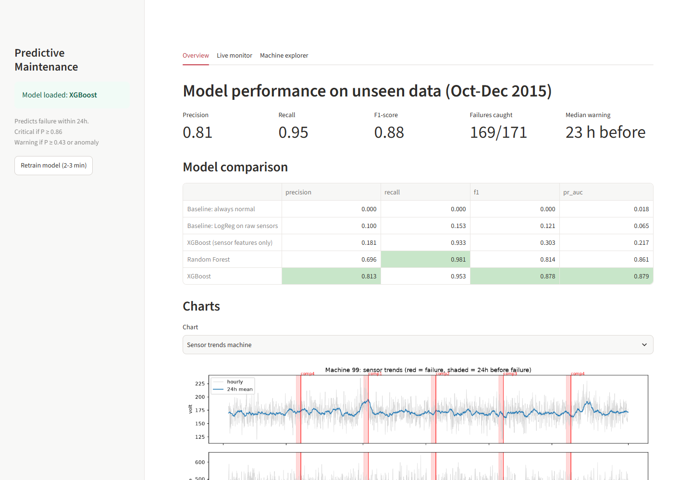
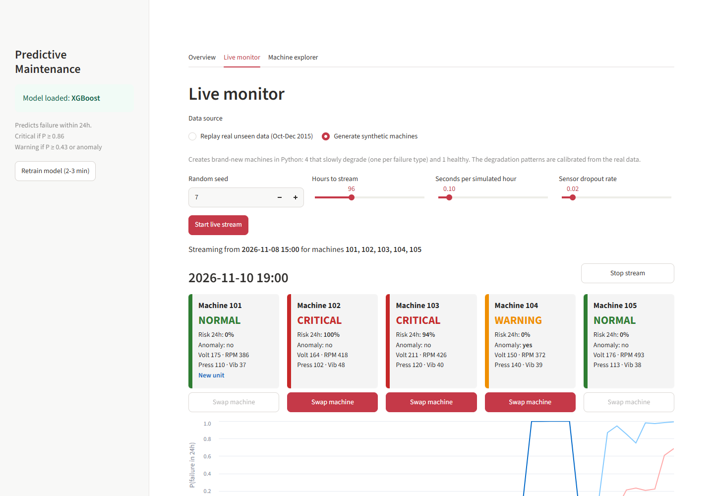
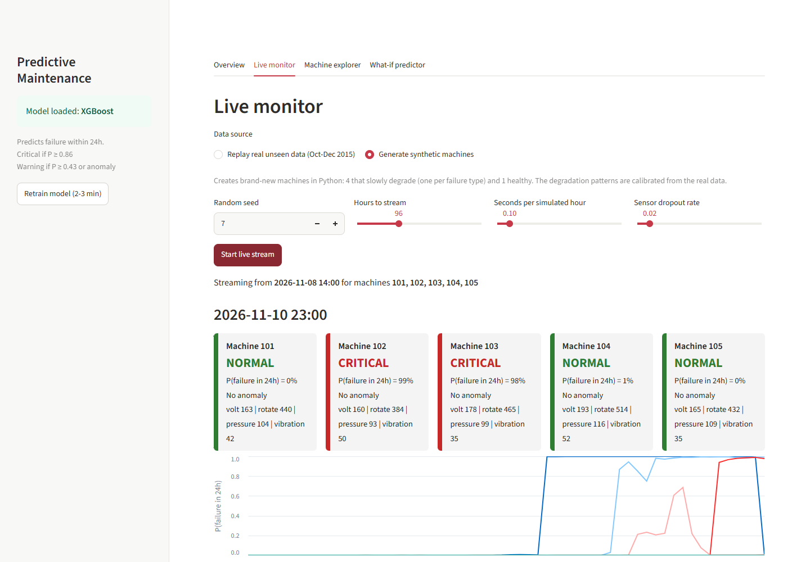
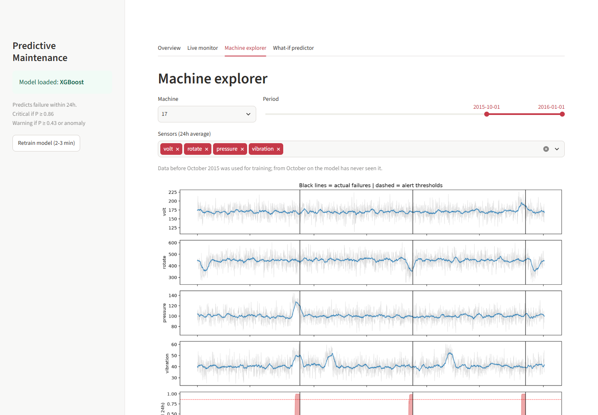
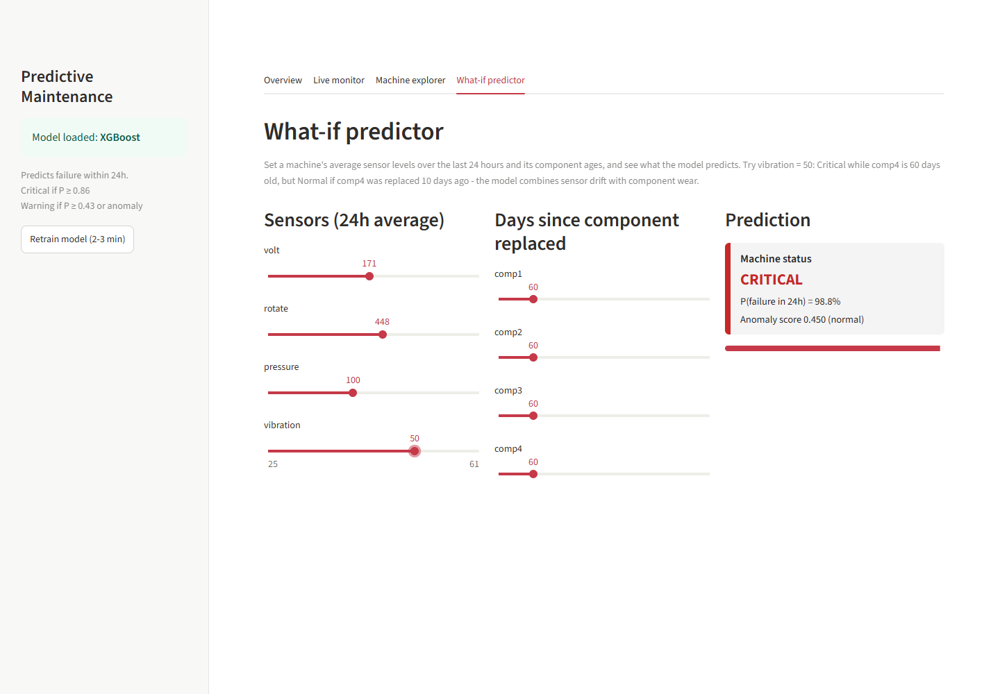

## Data

The files are the public Microsoft Azure predictive maintenance set (the same one usually listed on Kaggle). `src/data.py` downloads them from the [Microsoft SQL workshops repo](https://github.com/microsoft/sqlworkshops) and, if that copy fails, from a second GitHub mirror. They are saved under `data/`.

* `PdM_telemetry.csv`, 876,100 rows. 100 machines, one row an hour, from 1 Jan 2015 06:00 to 1 Jan 2016 06:00. Sensors: `volt`, `rotate`, `pressure`, `vibration`.
* `PdM_failures.csv`, 761 failures: comp2 259, comp1 192, comp4 179, comp3 131.
* `PdM_maint.csv`, 3,286 component replacements, planned and after a failure.

The original bundle also has an error log and a machine list (model and age). This project does not download them.

## Cleaning and the split

Duplicates are removed: exact copies, and a second row for the same machine and timestamp. Each machine is placed on a complete hourly grid. Missing hours and impossible readings are filled by interpolation along that machine. A reading is treated as a glitch when it falls outside the median ± 6 IQR. The limits are wide so a real drift is kept.

On this dump that pass removed 0 duplicate rows, filled 0 missing hours, and replaced 1 glitch. The cleaning is still used, because the live simulator deliberately drops sensor values.

During training the whole series is already available, so gaps are interpolated. In the live loop the next hour has not arrived, so a missing or out-of-range value is replaced with the last good reading for that sensor.

Each model pipeline has its own `StandardScaler`, fit on the training months only.

The split is by time:

* Train: before 1 September 2015
* Validation: September, for the alarm threshold and for choosing the model
* Test: from 1 October 2015 to the end of the file

The September cutoff is the threshold with the best F1. For the saved XGBoost model that cutoff is 0.86. Warning starts at half of it, 0.43, or when the anomaly model fires.

## Features

`src/features.py` is used both in training and in the live monitor, so both paths see the same columns.

Twenty of the 24 features come from the sensors. For each sensor: the raw value, a 3-hour mean, a 24-hour mean, a 24-hour standard deviation, and a trend (3-hour mean minus 24-hour mean).

The other four are hours since comp1, comp2, comp3, and comp4 were last replaced. Only maintenance recorded strictly before the current hour is used. A replacement logged at the failure itself would otherwise make that part look new at the moment it broke.

The day before a failure, the sensors move in a regular way:

| Failed part | What moves |
|---|---|
| comp1 | voltage up, about +4.6 standard deviations |
| comp2 | rotation down, about −4.8 |
| comp3 | pressure up, about +5.6 |
| comp4 | vibration up, about +5.4 |

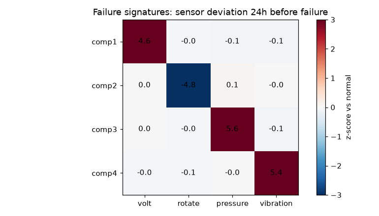

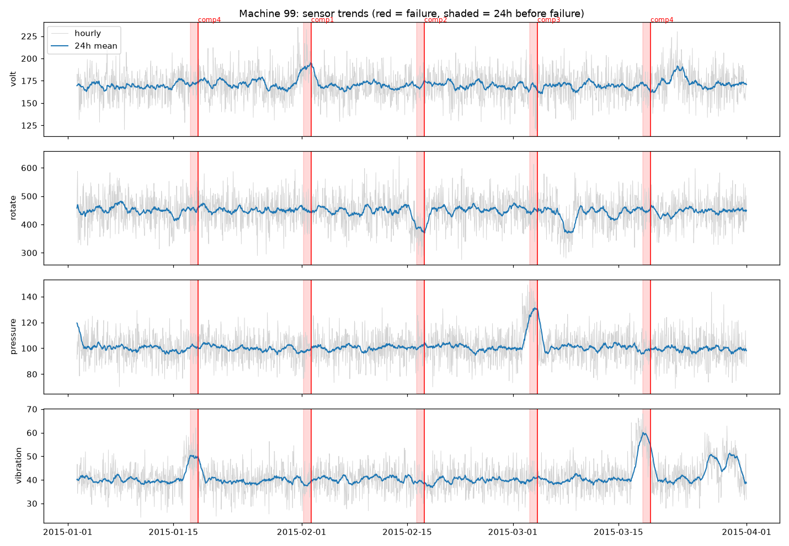
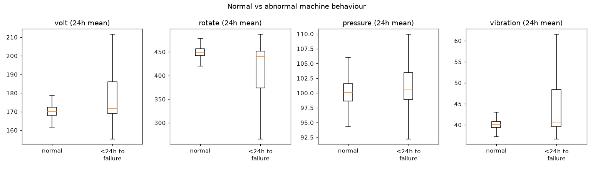

## Models

`src/train.py` fits five classifiers. The label is `failure_soon`: 1 when the machine's next failure is strictly less than 24 hours away, including the hour of the failure. A bit under 2% of hours are positive.

Logistic regression uses `class_weight="balanced"`. The random forest uses `class_weight="balanced_subsample"`. XGBoost sets `scale_pos_weight` to the number of normal hours divided by the number of failure hours. The always-normal baseline shows the score of a model that never alarms. Its threshold stays at 0.5. Every other threshold is chosen on September.

| Model, scored on the test period | Precision | Recall | F1 | PR-AUC |
|---|---|---|---|---|
| Always normal | 0.000 | 0.000 | 0.000 | 0.018 |
| Logistic regression, raw sensors | 0.100 | 0.153 | 0.121 | 0.065 |
| XGBoost, sensor features only | 0.181 | 0.933 | 0.303 | 0.217 |
| Random Forest, all 24 features | 0.696 | 0.981 | 0.814 | 0.861 |
| XGBoost, all 24 features (saved) | 0.813 | 0.953 | 0.878 | 0.879 |

The saved model is whichever of the two full-feature models had the higher September F1. That was XGBoost (0.900 vs 0.886). The test months are only a final score.

Rolling sensor features are enough to catch most failure hours. They also alarm on a lot of hours that never fail, which is why precision stays near 0.18 until component age is added. A high vibration reading on a worn comp4 is a different situation from the same reading a few days after that part was replaced.

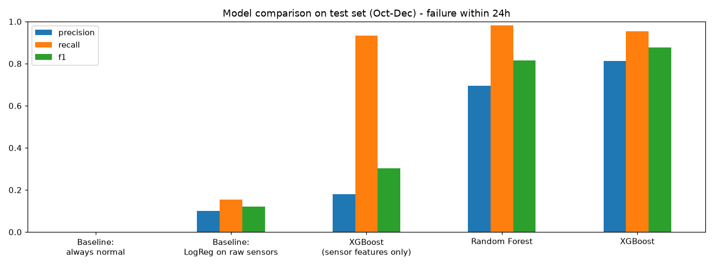
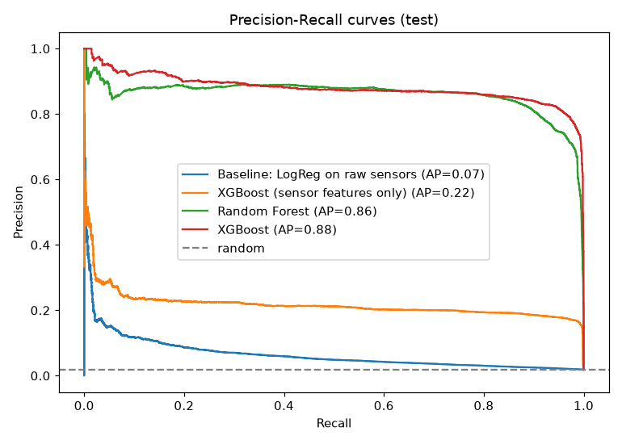

## Anomaly detection

An Isolation Forest is fit on training hours that are more than 72 hours from any failure. It sees the sensor features and no labels. Its threshold is the 99th percentile of normal September scores, which leaves about a 1% flag rate on quiet data.

On the test period it flags 1.1% of normal hours, 8.1% of hours that are 24–72 hours before a failure, and 15.2% of hours in the last day. About 55% of failures have at least one anomaly flag in the preceding 24 hours. That is well behind the XGBoost classifier. It also does not need a catalogue of past failures, so a new failure pattern can still raise Warning.

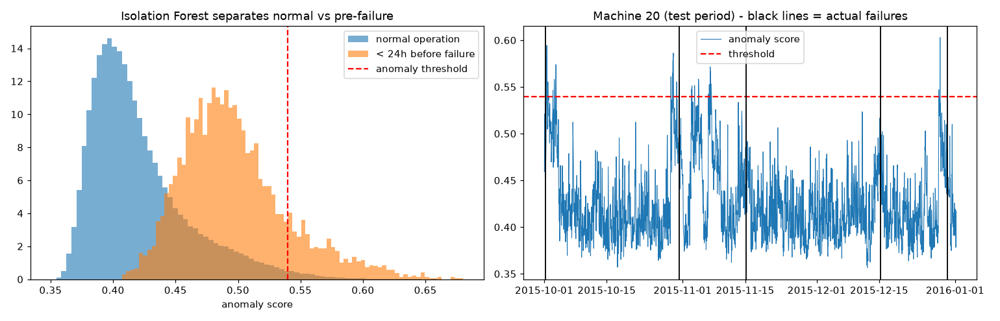

## Test-set mistakes

Hourly counts for the saved model: 3,864 true positives, 889 false positives, 189 false negatives, 216,558 true negatives.

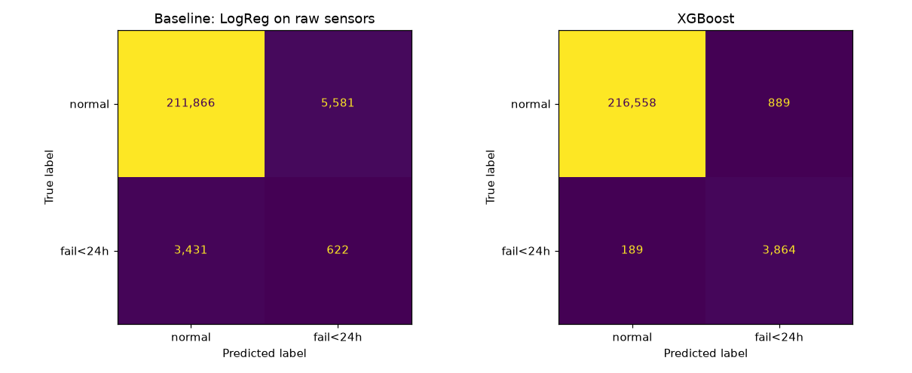

Of those 889 false-positive hours, 199 fall 24–72 hours before a real failure, so the alarm is early and the failure does arrive. None sit in the 3-to-7-day range. The other 690 are more than seven days from any failure.

By failure event, which is the count maintenance would actually use: 169 of 171 events were Critical at least once in the previous 24 hours. The median lead is 23 hours. The two misses are one comp3 and one comp4. Both still reached Warning. Per-component rates are in `outputs/metrics.json`: comp3 0.962, comp4 0.971, and 1.0 for the other components and for combined failures.

Worth doing next:

* Add the error log and the machine metadata from the original dataset. Small errors often show up before a hard failure.
* Predict which component fails, so the spare part can be ready.
* Require the alarm to stay on for several hours, and pick the threshold from the cost of a missed failure against the cost of a false one.
* Try an LSTM or a 1D-CNN on the raw sequence, and keep it only if it beats this XGBoost. Those libraries are left out of `requirements.txt` until then.
* Retrain on new months, and check that a probability of 0.9 really happens about 90% of the time.
* Use more than one validation month. This run uses September only.

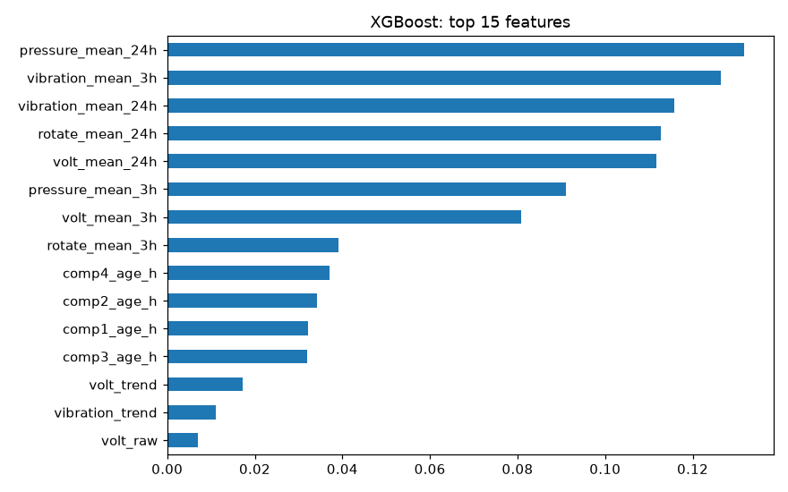

## Live simulation

`src/simulate.py` steps one hour at a time.

The default source is real telemetry from the test period. With no machine list it picks a window that contains three machines which actually fail, plus one healthy machine. Defaults are 96 hours, 0.05 seconds between ticks, a 2% sensor dropout, and seed 7. `--start` can pin the window, for example `2015-11-01`.

`--synthetic` uses `src/generator.py`. The new machines are numbered from 101. Four are scheduled to fail, one component type each, and one stays healthy. Drift starts 48 hours before the failure and takes 6 hours to reach full size: voltage +20, rotation −80, pressure +25, vibration +10. Those shifts, the noise level, and the ages are measured from the real data. Failed parts are set 45–120 days old. Other services sit on a 15-day cycle.

That 15-day gap matters. In the real failures, almost none happen within 15 days of a maintenance visit (about 0.5%). The model treats "recently serviced" as safe. A first version of the generator that broke freshly serviced machines produced almost no alerts. For this fleet that follows the data. Before using the same rule on another plant, it should be checked with the people who schedule the work.

Each hour, one `MachineMonitor` per machine validates the reading, keeps a 24-hour buffer, builds features, and runs both models. Status is Critical at probability ≥ 0.86, Warning at probability ≥ 0.43 or an anomaly, and Normal otherwise. Real failures are printed when their timestamp arrives. Every row is logged.

Swap exists on `MachineMonitor`, and the dashboard calls it. The terminal loop does not.

One line of terminal output looks like this:

```
[2015-11-26 09:00]  M1   Normal   p=0.00   | M17  Critical p=0.96   | M24  Normal   p=0.00
    >>> ACTUAL FAILURE: machine 17, comp2 replaced
```

`A` after the probability means the anomaly model fired on that hour. The summary at the end lists hours in each status and the lead time of the first Critical alert.

## Files

```
run.bat, run.sh           setup, then dashboard, train, or simulate
src/data.py               download, cleaning, 24-hour labels
src/features.py           the 24 features, shared by training and the live path
src/train.py              clean, compare five models, fit the anomaly model, save metrics
src/simulate.py           hour-by-hour replay or synthetic run
src/generator.py          healthy and degrading machines
src/dashboard.py          Streamlit UI
models/pdm_model.joblib   classifier, thresholds, anomaly model, sensor bounds
outputs/metrics.json      the numbers quoted above
outputs/figures/          plots from training
outputs/realtime_*.csv    logs from the latest live run
```
